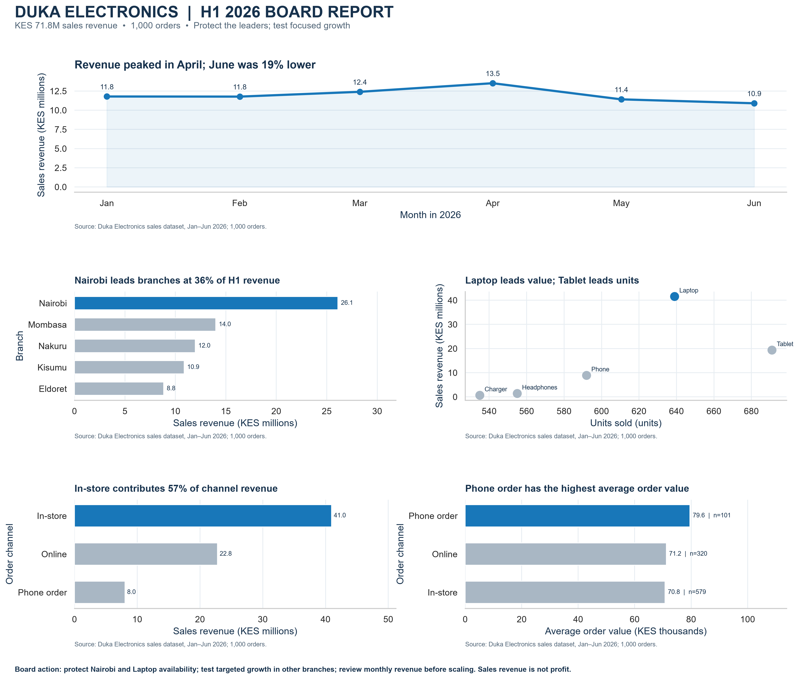

# Duka Electronics | H1 2026 Board Report



## Board Summary

The first half of 2026 generated KES 71.8 million in sales revenue across 1,000 orders. Nairobi contributed KES 26.1 million, more than any other branch, while Laptops led product revenue at KES 41.5 million. Tablets sold the most units, showing that sales volume and sales value tell different stories. Monthly revenue peaked in April at KES 13.5 million and fell to KES 10.9 million in June, the half-year low. In-store sales contributed the largest share of revenue; phone orders had the highest average order value, from fewer orders. For second-half planning, protect availability and customer experience for Nairobi and Laptop sales, while testing targeted demand-building in lower-revenue branches. Review the April-to-June decline to identify actionable causes, then monitor monthly revenue before expanding any intervention. These data describe sales value, not profit. Costs, inventory, customer, and promotion data are unavailable, so recommendations should be treated as testable priorities, not causal conclusions.

## Recommendation

Protect availability and customer experience for the leading Nairobi and Laptop revenue streams. Test targeted demand-building in lower-revenue branches and examine the April-to-June decline before scaling any intervention. Sales revenue is not profit; the dataset contains no cost, stock, customer, or promotion measures.

## Reproduce

The [board report notebook](board_report.ipynb) contains the storyboard, data checks, all chart code, and the before-and-after makeover. Outputs are saved under `reports/` and `figures/`.

```bash
pip install -r requirements.txt
jupyter nbconvert --to notebook --execute --inplace board_report.ipynb
```

See [dashboard.md](dashboard.md) for dashboard status and setup guidance.
